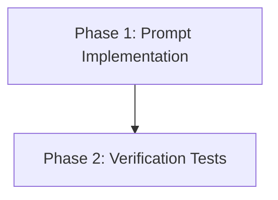

# Implementation Plan: Strict Academic Prompting (Issue #40)

**Overview**:
This plan implements a stricter, more formal system prompt for the Chat RAG system to ensure an academic tone and prevent hallucinations/guessing.

## 1. Dependency Graph

## 2. Execution Strategy Table
| Stage | Phase | Agent | Files Modified | Files Created | Execution Mode |
|-------|-------|-------|----------------|---------------|----------------|
| 1 | 1 | coder | `backend/src/functions/rag-query.js` | - | Sequential |
| 2 | 2 | tester | - | `backend/src/functions/rag-query.test.js` | Sequential |

## 3. Phase Details

### Phase 1: Prompt Implementation
- **Objective**: Update the `system` prompt in `rag-query.js` with the new strict persona and rules.
- **Agent**: `coder`
- **Files to Modify**:
    - `backend/src/functions/rag-query.js`:
        - Update `messages[0].content` (system prompt).
        - Ensure "formal tone", "no guessing", and specific refusal message are included.
- **Validation**:
    - Run `npm test` (if existing tests pass).
    - Manual inspection of the code.

### Phase 2: Verification Tests
- **Objective**: Create a unit test to verify that the `rag-query` handler correctly constructs the strict prompt and handles responses.
- **Agent**: `tester`
- **Files to Create**:
    - `backend/src/functions/rag-query.test.js`:
        - Mock `@azure/functions` and `../services/openai.js`.
        - Test 1: Verify system prompt contains "UADE Innova" and strict rules.
        - Test 2: Verify it includes the specific refusal string.
        - Test 3: Verify it handles a mock "No encontré información..." response correctly.
- **Validation**:
    - Run `npm test`.

## 4. File Inventory
| File Path | Phase | Purpose |
|-----------|-------|---------|
| `backend/src/functions/rag-query.js` | 1 | Update RAG system prompt |
| `backend/src/functions/rag-query.test.js` | 2 | Unit tests for prompt construction |

## 5. Execution Profile
- Total phases: 2
- Parallelizable: No (Sequential: Implementation -> Validation)
- Estimated time: 10-15 minutes

## 6. Token Budget & Cost Summary
| Phase | Agent | Model | Est. Input | Est. Output | Est. Cost |
|-------|-------|-------|-----------|------------|----------|
| 1 | coder | Pro | 2,000 | 500 | $0.04 |
| 2 | tester | Pro | 2,500 | 1,000 | $0.07 |
| **Total** | | | **4,500** | **1,500** | **$0.11** |
