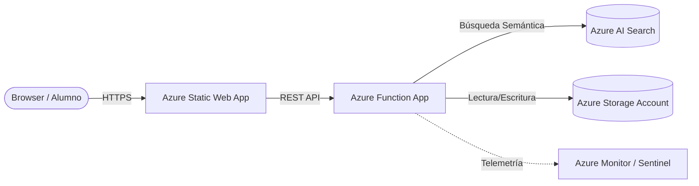

# 🚀 UADE Innova: Dashboard Educativo Inteligente

**UADE Innova** es una plataforma educativa de vanguardia diseñada para transformar la experiencia académica mediante **IA Generativa (RAG)**. Permite a alumnos y docentes interactuar con materiales de clase (transcripciones, presentaciones, apuntes y bibliografía) de una manera conversacional, analítica y multimodal.

## 🌟 Visión General
El sistema centraliza el conocimiento institucional mediante el procesamiento automático de materiales cargados por los docentes, generando resúmenes, mapas conceptuales, audios (TTS) y un chat inteligente (Bot RAG) que sirve como tutor 24/7.

- **Población:** Piloto inicial de **65 alumnos y docentes**.
- **Meta de Adopción:** 60% de uso activo durante el cuatrimestre.
- **Eficiencia FinOps:** Costo objetivo < $1.50 USD/mes por alumno.

## 🛠️ Stack Tecnológico (100% Serverless)
Para minimizar el CapEx y maximizar la escalabilidad, la arquitectura es enteramente **Serverless**:

- **Generative AI:** Azure OpenAI Service (`gpt-4o-mini` y `text-embedding-3-small`).
- **Vector Database:** Azure AI Search (vector index, cosine similarity).
- **Backend:** Azure Functions (**Consumption Plan Y1**) + Node.js 20/TypeScript.
- **Frontend:** Azure Static Web Apps (**Free Tier**) + React/Vite.
- **Identity:** Microsoft Entra ID (OIDC / SSO UADE).
- **Observability:** Azure Application Insights & Log Analytics.

## 🏗️ Arquitectura del Sistema
El sistema se basa en un pipeline de 4 capas:
1. **Ingesta:** Carga manual de materiales (Upload -> Storage).
2. **Conocimiento:** Extracción de texto, Chunking (512 tokens) y Generación de Embeddings.
3. **Inferencia (RAG):** Consulta del alumno -> Búsqueda semántica en Azure AI Search -> Respuesta con fuentes.
4. **Presentación:** Dashboard integrado con autenticación UADE.

### 📊 Diagrama de Arquitectura
El siguiente diagrama detalla la integración de los servicios de Azure con las fuentes de datos y observabilidad.

> **Nota:** Puedes abrir el archivo fuente [architecture_diagram.drawio](./architecture_diagram.drawio) en VS Code (con la extensión Draw.io) para visualizarlo de forma interactiva.

## 🚀 Estado Actual y Despliegue
- **✔ Infraestructura (IaC):** Desplegada exitosamente mediante Bicep y `azd`.
- **✔ Inteligencia:** Modelos de OpenAI y Azure AI Search configurados y operativos (dim: 1536).
- **✔ Backend/RAG:** Pipeline de ingesta y consulta RAG probado y validado.
- **✔ Frontend:** Dashboard operativo y conectado al backend.
- **🌐 URL pública:** https://agreeable-beach-002ff0c0f.6.azurestaticapps.net
- **🚧 Pendiente:** Habilitación de cuota de "Dynamic VMs" por parte de UADE para despliegue final en la nube (actualmente operativo en modo local).

## 💻 Desarrollo Local
1. Clona el repositorio.
2. Configura las variables en `.env.local` (AZURE_OPENAI_ENDPOINT, AZURE_SEARCH_ENDPOINT, AZURE_SEARCH_INDEX_NAME, etc.).
3. Levanta el backend: `cd backend && func start`.
4. Levanta el frontend: `cd frontend && npm run dev`.

---
*Desarrollado por [Lucas Vidmar](https://github.com/lucasvidmar)*
