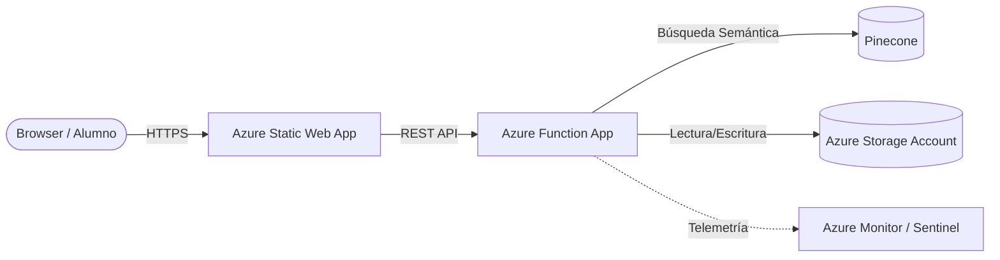

# Project Context for AI Agents — UADE Innova

_This file is the **single source of truth** for AI agents implementing code in this project. It consolidates rules from AGENTS.md, README.md, SECURITY_TODO.md, and DESIGN.md. Agents must not rely on external context files._

---

## 1. Technology Stack & Versions

| Layer | Technology | Version / Notes |
|---|---|---|
| Frontend bundler | Vite | 5.4.2 (ESM, no `vite.config.js` present) |
| Frontend language | Vanilla JS (ES Modules) | No React, no Vue. `type: "module"` in `package.json` |
| Frontend hosting | Azure Static Web Apps | Free tier, CDN global, SSL auto |
| E2E Testing | Playwright | 1.53.1 |
| Backend runtime | Azure Functions | Node.js 20+, Extension Bundle `[4.*, 5.0.0)` |
| Backend language | JavaScript (ES Modules) | `type: "module"` in `backend/package.json` |
| AI Embeddings | Azure OpenAI | `text-embedding-3-small` |
| AI Chat | Azure AI Foundry | `DeepSeek V4 Flash` |
| Vector DB | Pinecone | Serverless/Standard, 1536 dim, cosine similarity |
| Storage | Azure Blob Storage + Table Storage | Containers: `class-materials`, `processed` |
| Secrets | Azure Key Vault | Only for production; local uses `.env.local` |
| IaC | Bicep + azd | `azure.yaml` is the manifest; never create resources manually |
| Observability | Application Insights | 3.14.0; linked to Functions |
| File parsing | mammoth (docx), pdf-parse, js-tiktoken | Token counting for chunking |
| Auth | API Keys / Connection Strings | **No Managed Identities** (RBAC permissions unavailable) |

---

## 2. Architecture Overview

100% Serverless architecture. No VMs reserved.

1. **Ingesta (Upload-Triggered):** Docente sube materiales (TXT/DOCX/VTT/PPTX/PDF) → HTTP trigger a Azure Functions.
2. **Conocimiento:** Parseo → Chunking (512 tokens, 50 overlap) → Embeddings → Upsert a Pinecone con metadatos (`subjectId`, `classId`, `materialType`, `lectureDate`).
3. **Inferencia (RAG):** Query del alumno → Embedding → Pinecone similarity search con filtro de metadatos → Augmentation → DeepSeek response con fuentes.
4. **Presentación:** Dashboard HTML+JS integrado con SSO (Microsoft Entra ID).

**Mermaid:**


**Public URL (prod):** https://agreeable-beach-002ff0c0f.6.azurestaticapps.net

---

## 3. Data Models (Canonical Types)

These are the **only** valid type definitions. Use them exactly.

### Material
```typescript
interface Material {
  id: string;                  // UUID generado al subir
  classId: string;             // ID de la clase a la que pertenece
  subjectId: string;           // ID de la materia (para filtros RAG)
  type: "transcript" | "presentation" | "notes" | "bibliography";
  filename: string;
  mimeType: string;
  status: "pending" | "processing" | "ready" | "error";
  uploadedAt: string;          // ISO 8601
  processedAt?: string;        // ISO 8601, se setea al finalizar el pipeline
  blobUrl: string;             // URL del archivo en Azure Blob Storage
}
```

### Class
```typescript
interface Class {
  id: string;
  subjectId: string;
  title: string;               // Ej: "Clase 3 - Arquitecturas de Software"
  date: string;                // ISO 8601
  topics: string[];            // Temas planificados
  materials: Material[];       // Materiales cargados para esta clase
  summaryReady: boolean;       // true si el docente ya validó el resumen IA
}
```

### PineconeMetadata
```typescript
interface PineconeMetadata {
  subjectId: string;
  classId: string;
  materialId: string;
  materialType: "transcript" | "presentation" | "notes" | "bibliography";
  chunkIndex: number;
  sourceFilename: string;
  lectureDate: string;         // ISO 8601
}
```

---

## 4. API Contracts (Azure Functions)

All functions live in `backend/src/functions/`.

### POST `/api/ingest-material`
- **Request:** `multipart/form-data` with fields: `file`, `classId`, `subjectId`, `materialType`
- **Response `202 Accepted`:** `{ "materialId": "uuid", "status": "processing" }`
- **Pipeline:**
  1. Upload raw file to Blob Storage: `class-materials/{classId}/{materialId}`
  2. Extract text: `.vtt/.txt` → direct, `.docx` → mammoth, `.pdf` → pdf-parse, `.pptx` → pptxgen
  3. Chunk: 512 tokens, 50 token overlap (use `js-tiktoken`)
  4. Generate embeddings with `text-embedding-3-small`
  5. Upsert to Pinecone with `PineconeMetadata`
  6. Update `Material.status` to `"ready"`

### POST `/api/rag-query`
- **Request:** `{ "question": "...", "classIds": ["..."], "subjectId": "..." }`
- **Response `200 OK`:** `{ "answer": "...", "sources": [{ materialType, classId, chunkIndex, sourceFilename }] }`

### GET `/api/classes?subjectId={id}`
- **Response:** `Class[]` with nested `Material[]`

### Other existing endpoints
The codebase already contains ~35 functions including: `chat-api`, `classes-api`, `get-tasks`, `get-profile`, `save-profile`, `global-search`, `deadlines`, `notifications`, `admin-api`, `analytics`, `audio-api`, `sga-api`, `vector-health`, `process-material`, and more. Always check `backend/src/functions/` before creating a new one.

---

## 5. Critical Implementation Rules

### 5.1 Authentication & Security (HARD CONSTRAINTS)
- **No RBAC / Managed Identities:** The resource group lacks permissions. All inter-service auth uses **API Keys and Connection Strings** via environment variables.
- **Never hardcode secrets:** All keys live in `.env.local` (local) or Azure App Settings (prod). `local.settings.json` is gitignored.
- **Current auth level is `anonymous`:** This is intentional for local dev but **must not** be left in production. Future upgrade path: `authLevel: "function"` or Entra ID Bearer tokens.
- **CORS:** Currently `--cors "*"` for local debugging. Production must restrict origins to the Static Web App URL only.
- **Rate limiting:** Not yet implemented. Future requirement: per-user quota on RAG queries and per-teacher upload quota.
- **Content safety:** Enable Azure OpenAI Content Safety filters in production. Log "unanswered" queries for audit.

### 5.2 Secrets & Environment Variables
These are generated by `azd provision`. Never commit them.

```bash
# Azure OpenAI
AZURE_OPENAI_ENDPOINT=https://<rs-openai-llm>.openai.azure.com/
AZURE_OPENAI_EMBEDDING_DEPLOYMENT=text-embedding-3-small
AZURE_OPENAI_TTS_DEPLOYMENT=tts-1

# Azure AI Foundry (DeepSeek)
AI_FOUNDRY_DEEPSEEK_ENDPOINT=https://<model>.<region>.models.ai.azure.com/v1
AI_FOUNDRY_DEEPSEEK_KEY=...
AI_FOUNDRY_DEEPSEEK_MODEL=deepseek-v4-flash

# Pinecone
PINECONE_HOST=https://<index>.svc.pinecone.io
PINECONE_INDEX_NAME=dashboard-edu-pilot
PINECONE_API_KEY=...

# Azure Storage
AZURE_STORAGE_ACCOUNT_NAME=stdashboard{token}
AZURE_STORAGE_CONTAINER_MATERIALS=class-materials

# Frontend (auto-generated by azd prepackage hook)
VITE_API_BASE_URL=https://func-dashboard-ingest-{token}.azurewebsites.net/api
```

### 5.3 Code Conventions
- **Backend language:** JavaScript (Node.js 20), ES Modules. TypeScript only if library demands it.
- **Frontend language:** HTML + Vanilla JS. No React, no Vue, no Svelte.
- **No CSS frameworks:** Vanilla CSS with CSS variables (tokens). See Design System below.
- **File naming:** kebab-case (`ingest-material.js`, `chat-widget.js`).
- **Function naming:** camelCase.
- **Azure resource naming:** kebab-case with type prefix (`func-`, `app-`, `aoai-`, `st-`, `rg-`).
- **Logging:** Use `context.log()` in Functions. Every error must include `materialId` or `classId` for App Insights correlation.

### 5.4 Chunking & Embeddings
- **Chunk size:** 512 tokens.
- **Overlap:** 50 tokens.
- **Token counter:** `js-tiktoken`.
- **Model:** `text-embedding-3-small` (1536 dimensions).
- **Metadata filter:** Always filter by `subjectId` (and optionally `classId`) to prevent cross-subject data leakage.

### 5.5 File Parsing Matrix
| Extension | Parser |
|---|---|
| `.txt`, `.vtt` | Direct read |
| `.docx` | mammoth |
| `.pdf` | pdf-parse |
| `.pptx` | pptxgen (or native parser) |

### 5.6 No Mocks in Production
- SGA (notas/asistencia) mocks are **frontend-only** for prototyping.
- Backend endpoints must be ready to connect to a real SGA API.

### 5.7 Testing
- **Backend:** Native Node.js test runner: `node --experimental-test-module-mocks --test src/**/*.test.js`
- **Frontend E2E:** Playwright (`npm run test:e2e`)
- **Co-located tests:** Every function/service should have a `.test.js` file in the same directory.

---

## 6. Design System (CSS Variables)

The UI uses a **dark-first** glassmorphism-inspired design.

### Brand Colors
- `--primary`: #00405C (Astronaut Blue)
- `--primary-light`: #00608A
- `--primary-dark`: #002D41
- `--accent`: #0077AB
- `--accent-glow`: rgba(0, 64, 92, 0.15)

### Semantic Colors
- `--success`: #10b981
- `--warning`: #f59e0b
- `--error`: #ef4444
- `--info`: #38bdf8

### Dark Theme (Default)
- `--bg`: #061B2C
- `--surface-1`: #0C253B
- `--surface-2`: #12304A
- `--surface-3`: #1A3C5C
- `--border`: rgba(255, 255, 255, 0.08)
- `--text-primary`: #f1f5f9
- `--text-secondary`: #94a3b8
- `--text-muted`: #475569

### Light Theme
- `--bg`: #f1f5f9
- `--surface-1`: #ffffff
- `--surface-2`: #e2e8f0
- `--text-primary`: #061B2C

### Typography
- **Font:** Montserrat (or system fallback)
- **Headlines:** Bold/ExtraBold (700/800), letter-spacing: -0.02em
- **Body:** Regular/Medium (400/500), line-height: 1.6

### Spacing & Radius
- **Base unit:** 4px
- **Radii:** sm=6px, md=10px, lg=16px, xl=24px, full=9999px

### Do's and Don'ts
- **DO** use CSS variables for all colors.
- **DO** use Montserrat for typography.
- **DO** use 4px grid for spacing.
- **DON'T** use hard-coded colors.
- **DON'T** use sharp corners (always use radius tokens).
- **DO** add micro-animations (0.2s cubic-bezier) on interactive elements.

---

## 7. Deployment Lifecycle (MANDATORY)

Every implementation task must follow this cycle:

1. **Implement locally** → test with `func start` and `npm run dev`.
2. **Deploy immediately** → `azd deploy` (from project root).
3. **Test in browser** → Navigate to the public Static Web App URL.
4. **Verify E2E** → Confirm integration between frontend, Functions, and Pinecone.
5. **Task closure** → Only complete after visual confirmation in the deployed environment.

**Infrastructure changes** → `azd provision` (never create resources via Azure Portal).

---

## 8. Directory Structure (Monorepo)

```
azure-educational-dashboard/
├── azure.yaml                   # azd manifest
├── .env.local                   # Local secrets (gitignored)
├── infra/                       # Bicep modules
│   ├── main.bicep
│   └── modules/
├── frontend/
│   ├── index.html
│   ├── src/
│   │   ├── pages/               # student/, teacher/, director/
│   │   ├── components/          # Vanilla JS components
│   │   ├── services/            # api.js, HTTP clients
│   │   └── styles/              # CSS variables + component styles
│   └── package.json
├── backend/
│   ├── host.json
│   ├── local.settings.json      # Local config (gitignored)
│   ├── src/
│   │   ├── functions/           # All Azure Functions
│   │   ├── services/            # Shared business logic
│   │   └── prompts/             # LLM prompt templates
│   └── package.json
└── scripts/                     # Utility scripts
```

**Rule:** Create files **only** inside these directories. Do not add new top-level folders without justification.

---

## 9. Infrastructure as Code (Bicep)

- Resources are defined in `infra/modules/*.bicep`.
- `infra/main.bicep` is the orchestrator.
- `azure.yaml` declares services and hooks (auto-builds frontend on deploy).
- Read `infra/main.bicep` before writing code that consumes Azure resources.

### Key Resources
| Resource | Name Pattern | Notes |
|---|---|---|
| Resource Group | `RG_UADE_INNOVA_DEV` | Assigned by UADE |
| Azure OpenAI | `RS-OPENAI-LLM` | Existing in eastus2 |
| Azure Functions | `func-dashboard-ingest-{token}` | Consumption Y1 |
| Azure Storage | `stdashboard{token}` | max 24 chars |
| Static Web App | `stapp-dashboard-{token}` | Free tier |
| App Insights | `appi-dashboard-{token}` | |
| Key Vault | `kv-edu-{token}` | |

---

## 10. Security To-Do (Post-MVP)

These items are tracked but **not yet implemented**. Do not implement them unless explicitly asked.

| Priority | Item | Action |
|---|---|---|
| Critical | API Authentication | Move from `anonymous` to `function` or Entra ID Bearer |
| Critical | CORS Restriction | Restrict to production SWA URL only |
| Medium | Secret Management | Full Key Vault + Managed Identities (when RBAC available) |
| Medium | Rate Limiting | Per-user RAG quota, per-teacher upload quota |
| Medium | Prompt Monitoring | Content Safety filters + audit logging |

---

## 11. Reference Commands

```bash
azd init                          # Initialize project
azd provision                     # Deploy infrastructure
azd deploy                        # Deploy app code
azd down                          # Destroy environment
func start                        # Local Functions
npm run dev                       # Local frontend (Vite)
npm run test:e2e                  # Playwright E2E tests
node --experimental-test-module-mocks --test src/**/*.test.js  # Unit tests
```

---

## 12. Usage Guidelines

**For AI Agents:**

- Read this file before implementing any code.
- Follow ALL rules exactly as documented.
- When in doubt, prefer the more restrictive option.
- Update this file if new patterns emerge.
- Do NOT rely on AGENTS.md, README.md, SECURITY_TODO.md, or DESIGN.md — this file is the single source of truth.

**For Humans:**

- Keep this file lean and focused on agent needs.
- Update when the technology stack or design system changes.
- Review quarterly for outdated rules.
- Remove rules that become obvious over time.

---

*Context generated: 2026-05-08. This document replaces AGENTS.md, README.md, SECURITY_TODO.md, and DESIGN.md as the authoritative source for AI agents.*
